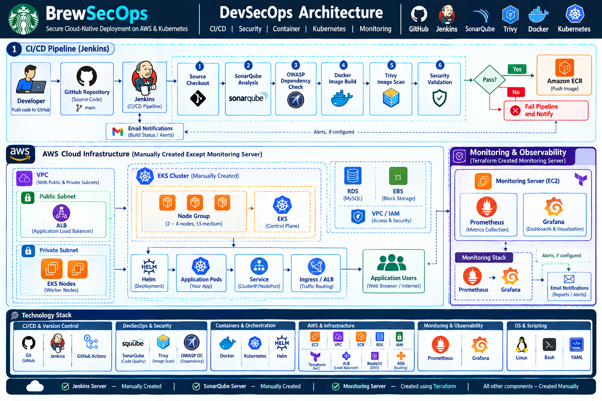
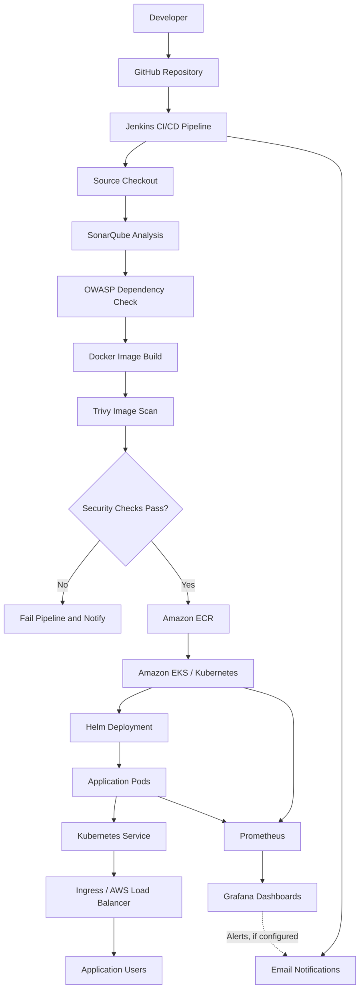

# ☕ BrewSecOps — Secure Cloud-Native Deployment on AWS & Kubernetes

### 🚀 Automating CI/CD, DevSecOps, Containerization, Kubernetes Deployment & Monitoring

BrewSecOps is a cloud-native DevSecOps project designed to automate application delivery through a Jenkins CI/CD pipeline, integrate security checks into the software development lifecycle, deploy containerized applications on Kubernetes, and monitor application and infrastructure health using Prometheus and Grafana.
<p align="center">
  
</p>
The project combines **CI/CD automation, DevSecOps practices, Infrastructure as Code, container orchestration, and observability** into a single end-to-end workflow.

[](https://git-scm.com/)
[](https://github.com/)
[](https://github.com/features/actions)
[](https://www.jenkins.io/)
[](https://www.sonarsource.com/products/sonarqube/)
[](https://owasp.org/www-project-dependency-check/)
[](https://trivy.dev/)
[](https://www.docker.com/)
[](https://kubernetes.io/)
[](https://helm.sh/)
[](https://aws.amazon.com/)
[](https://aws.amazon.com/eks/)
[](https://aws.amazon.com/ecr/)
[](https://aws.amazon.com/ec2/)
[](https://aws.amazon.com/elasticloadbalancing/application-load-balancer/)
[](https://www.terraform.io/)
[](https://www.cloudflare.com/)
[](https://prometheus.io/)
[](https://grafana.com/)
[](https://www.linux.org/)
[](https://www.gnu.org/software/bash/)
[](https://yaml.org/)
[](https://groovy-lang.org/)

---

## 📌 Table of Contents

- [Project Overview](#-project-overview)
- [Key Features](#-key-features)
- [Technology Stack](#-technology-stack)
- [Architecture](#-architecture)
- [End-to-End Pipeline Flow](#-end-to-end-pipeline-flow)
- [DevSecOps Pipeline Stages](#-devsecops-pipeline-stages)
- [Deployment Architecture](#-deployment-architecture)
- [Monitoring and Observability](#-monitoring-and-observability)
- [Project Structure](#-project-structure)
- [Prerequisites](#-prerequisites)
- [Getting Started](#-getting-started)
- [Configuration](#-configuration)
- [Security Best Practices](#-security-best-practices)
- [Troubleshooting](#-troubleshooting)
- [Future Improvements](#-future-improvements)
- [Author](#-author)

---

## 📖 Project Overview

Traditional application deployment can involve repetitive manual steps, inconsistent environments, delayed security checks, and limited visibility into application health.

BrewSecOps aims to improve this workflow by integrating automation and security checks into the application delivery process.

### 🎯 Project Objectives

- Automate application build and delivery using Jenkins.
- Integrate static code analysis and vulnerability scanning.
- Build and distribute container images using Docker and Amazon ECR.
- Deploy and manage containerized workloads using Kubernetes and Helm.
- Provision cloud infrastructure using Terraform.
- Expose applications through Kubernetes networking and AWS load-balancing components.
- Monitor application and infrastructure metrics using Prometheus and Grafana.
- Improve deployment consistency, security visibility, and operational troubleshooting.

## ✨ Key Features

| Feature | Description |
|---|---|
| CI/CD Automation | Jenkins pipeline for automated application delivery |
| Code Quality | SonarQube analysis and quality-gate integration |
| Vulnerability Scanning | Trivy filesystem/image scanning and OWASP Dependency-Check integration |
| Containerization | Docker-based application packaging |
| Container Registry | Amazon Elastic Container Registry (ECR) |
| Container Orchestration | Kubernetes deployments, services, and configuration |
| Package Management | Helm charts for reusable Kubernetes deployment configuration |
| Cloud Infrastructure | AWS infrastructure and Terraform-based provisioning |
| Traffic Management | Kubernetes Ingress and AWS Application Load Balancer integration |
| Monitoring | Prometheus metrics collection |
| Visualization | Grafana dashboards |
| Notifications | Jenkins email notifications for pipeline outcomes |

*Feature availability depends on the corresponding configuration being present and operational in the current repository.*

---

## 🛠️ Technology Stack

### CI/CD and Version Control

- **Git & GitHub** — source control and code collaboration
- **Jenkins** — CI/CD pipeline orchestration
- **GitHub Actions** — automation and validation for supported repository workflows

### DevSecOps and Security

- **SonarQube** — static code analysis and code-quality checks
- **Trivy** — filesystem, dependency, and container-image vulnerability scanning
- **OWASP Dependency-Check** — third-party dependency vulnerability analysis

### Containers and Orchestration

- **Docker** — container image creation and packaging
- **Kubernetes** — application deployment and orchestration
- **Helm** — Kubernetes package and release management
- **Amazon ECR** — private container image registry
- **Amazon EKS** — managed Kubernetes service

### AWS and Infrastructure as Code

- **Amazon EC2** — virtual machines for supported infrastructure and tooling
- **Amazon VPC** — network isolation and connectivity
- **AWS IAM** — identity and access management
- **AWS Application Load Balancer** — application traffic routing
- **Terraform** — infrastructure provisioning and configuration management
- **Cloudflare** — DNS and edge services, where configured

### Monitoring and Observability

- **Prometheus** — metrics collection and querying
- **Grafana** — monitoring dashboards and visualization
- **Alerting integrations** — notification workflows, where configured

### Operating Systems and Scripting

- Linux
- Bash and shell commands
- YAML
- Jenkins Pipeline / Groovy
- HTML, CSS, and JavaScript for the application, where applicable

---

## 🏗️ Architecture

The following diagram represents the intended end-to-end architecture of BrewSecOps. Individual integrations should be enabled and verified in the actual environment.



### Architecture Components

**1. Source code management**

Developers push application changes to GitHub. Jenkins retrieves the source code and begins the configured pipeline.

**2. Continuous integration**

Jenkins executes the configured build and validation stages, including code-quality analysis and security scanning.

**3. Container image creation**

Docker packages the application and its runtime dependencies into a container image.

**4. Image security validation**

Trivy scans the relevant filesystem or container image. The pipeline should stop when a configured blocking security condition is met.

**5. Container image storage**

Approved images are pushed to Amazon ECR for subsequent deployment.

**6. Kubernetes deployment**

Kubernetes runs the application in pods. Helm provides reusable configuration for deploying and updating the application.

**7. Traffic routing**

A Kubernetes Service and configured Ingress or AWS load-balancing integration provide access to the application.

**8. Monitoring and observability**

Prometheus collects configured metrics, while Grafana visualizes application and infrastructure health.

---

## 🔄 End-to-End Pipeline Flow

The complete delivery workflow is organized into the following stages.

### Stage 1 — Source Code Checkout

**Tools:** Git, GitHub, Jenkins

- Trigger the pipeline according to the configured webhook or build schedule.
- Check out the required branch.
- Retrieve the latest application source code.

### Stage 2 — Code Quality Analysis

**Tool:** SonarQube

- Analyze supported source code.
- Identify code-quality issues and potential bugs.
- Evaluate the configured quality gate.
- Stop the pipeline if the configured quality gate fails.

### Stage 3 — Dependency Security Analysis

**Tool:** OWASP Dependency-Check

- Analyze supported application dependencies.
- Identify dependencies associated with known vulnerabilities.
- Review the generated vulnerability report.
- Apply failure thresholds if configured in the pipeline.

### Stage 4 — Docker Image Build

**Tool:** Docker

- Build the application image using the Dockerfile.
- Apply an appropriate image tag.
- Validate that the image builds successfully.

### Stage 5 — Vulnerability Scanning

**Tool:** Trivy

- Scan the filesystem or built container image.
- Identify known vulnerabilities in operating-system packages and application dependencies.
- Review the severity of findings.
- Enforce configured security thresholds before publishing the image.

### Stage 6 — Container Registry Push

**Tools:** Amazon ECR, AWS IAM

- Authenticate securely to Amazon ECR.
- Tag the image with the target registry and repository.
- Push the approved image.
- Record the image tag or digest for deployment.

### Stage 7 — Kubernetes Deployment

**Tools:** Amazon EKS, Kubernetes, Helm

- Retrieve the approved container image.
- Apply Kubernetes manifests or deploy the Helm chart.
- Configure deployments, services, secrets, and other required resources.
- Check pod readiness and deployment rollout status.

### Stage 8 — Application Exposure

**Tools:** Kubernetes Service, Ingress, AWS Application Load Balancer

- Route traffic to healthy application pods.
- Configure the required networking and load-balancing integration.
- Verify application access using the configured endpoint.

### Stage 9 — Monitoring and Visualization

**Tools:** Prometheus, Grafana

- Collect configured application and infrastructure metrics.
- Query metrics in Prometheus.
- Visualize relevant metrics using Grafana dashboards.
- Investigate failures, resource utilization, and service availability.

### Stage 10 — Pipeline Notifications

**Tool:** Jenkins Email Extension or configured email integration

- Notify the configured recipients about pipeline success or failure.
- Include useful build information and diagnostic details.
- Send monitoring alerts only when the relevant alerting rules and notification integrations are configured.

### Pipeline Summary

```text
Developer Push
      |
      v
GitHub Repository
      |
      v
Jenkins Pipeline
      |
      v
Source Checkout
      |
      v
SonarQube Quality Gate
      |
      v
OWASP Dependency Analysis
      |
      v
Docker Image Build
      |
      v
Trivy Security Scan
      |
      v
Security Validation
      |
      +---- Failure ---> Stop Pipeline / Notify
      |
      v
Amazon ECR
      |
      v
Amazon EKS
      |
      v
Helm / Kubernetes Deployment
      |
      v
Service / Ingress / Load Balancer
      |
      v
Running Application
      |
      v
Prometheus ---> Grafana
      |
      v
Monitoring and Troubleshooting
```

---

## 🔐 DevSecOps Pipeline

BrewSecOps follows a **shift-left security approach** by introducing code-quality and vulnerability checks before application delivery.

| Security layer | Tool | Purpose |
|---|---|---|
| Source code | SonarQube | Static analysis and code-quality checks |
| Dependencies | OWASP Dependency-Check | Identify known third-party dependency vulnerabilities |
| Filesystem | Trivy | Scan supported files and dependencies |
| Container image | Trivy | Identify image vulnerabilities |
| Registry | Amazon ECR | Store container images with controlled access |
| Cloud access | AWS IAM | Apply identity and permission controls |

**Important:** A security scanner reporting vulnerabilities does not automatically mean the pipeline blocks deployment. Blocking behavior depends on the configured quality gates, exit codes, and severity thresholds.

---

## ☸️ Kubernetes Deployment

BrewSecOps uses Kubernetes concepts to manage application workloads and provide consistent deployment configuration.

The deployment configuration may include:

- **Deployments:** manage application replicas and rolling updates.
- **Services:** provide stable network access to pods.
- **Ingress:** configure HTTP/HTTPS routing when an Ingress controller is installed.
- **ConfigMaps:** store non-sensitive configuration.
- **Secrets:** supply sensitive configuration through an appropriate secrets-management process.
- **Readiness and liveness probes:** help Kubernetes determine application health.
- **Resource requests and limits:** define resource allocation and constraints.
- **Horizontal Pod Autoscaler:** scale workloads when metrics and prerequisites are configured.
- **Helm:** package and manage Kubernetes releases.

### Useful Verification Commands

```bash
kubectl get nodes
kubectl get namespaces
kubectl get deployments -A
kubectl get pods -A
kubectl get services -A
kubectl get ingress -A
```

Check a deployment rollout:

```bash
kubectl rollout status deployment/<deployment-name> -n <namespace>
```

Inspect a pod:

```bash
kubectl describe pod <pod-name> -n <namespace>
kubectl logs <pod-name> -n <namespace>
```

Replace the placeholders with the names from your environment.

---

## 📊 Monitoring and Observability

Prometheus and Grafana provide visibility into the behavior of the application and its supporting infrastructure.

### Prometheus

Prometheus collects configured metrics from supported targets and provides a query language for investigating system behavior.

Example PromQL queries:

**Target availability**

```promql
up
```

**CPU utilization**

```promql
100 * (1 - avg by (instance) (
  rate(node_cpu_seconds_total{mode="idle"}[5m])
))
```

This CPU query requires a compatible node exporter and its metrics to be available.

**HTTP request rate**

```promql
rate(http_requests_total[5m])
```

This query requires the application or exporter to expose the `http_requests_total` metric.

### Grafana

Grafana dashboards can visualize:

- CPU and memory utilization
- Pod and node health
- Application request rates
- HTTP error rates
- Service availability
- Container resource consumption

Dashboard panels depend on the metrics actually exposed by the configured exporters and application instrumentation.

### Alerting

Useful future or configurable alerting scenarios include:

- Application endpoint unavailable
- Pod repeatedly restarting
- Deployment replicas unavailable
- High CPU or memory utilization
- Elevated HTTP 5xx error rates
- Monitoring target down

Prometheus alert rules, Alertmanager, and notification integrations must be configured before these scenarios can generate operational alerts.

---

## 📁 Project Structure

The following is a logical overview of the repository. Keep only directories that exist in your actual GitHub repository and update the filenames to match your implementation.

```text
brewsecureops/
│
├── app/
│   ├── index.html
│   ├── css/
│   ├── js/
│   └── ...
│
├── docker/
│   └── Dockerfile
│
├── terraform/
│   ├── main.tf
│   ├── variables.tf
│   ├── outputs.tf
│   └── ...
│
├── kubernetes/
│   ├── deployment.yaml
│   ├── service.yaml
│   ├── ingress.yaml
│   └── ...
│
├── security/
│   ├── sonarqube/
│   ├── trivy/
│   └── owasp/
│
├── monitoring/
│   ├── prometheus/
│   └── grafana/
│
├── scripts/
│   └── ...
│
├── docs/
│   └── ...
│
├── screenshots/
│   └── ...
│
├── Jenkinsfile
├── .gitignore
└── README.md
```

---

## ⚙️ Prerequisites

Install the tools required for the components you want to run.

- Git
- Docker
- Jenkins with the required plugins and tool configurations
- SonarQube server and scanner
- Trivy
- OWASP Dependency-Check
- AWS CLI
- Terraform, if provisioning infrastructure through Terraform
- `kubectl` and Helm for Kubernetes deployment
- An AWS account with appropriate IAM permissions
- An Amazon ECR repository
- An Amazon EKS cluster and worker capacity, if deploying to EKS
- Prometheus and Grafana, if enabling monitoring

Some tools may run on separate servers or inside containers. They do not all need to be installed on one machine.

## 🚀 Getting Started

### 1. Clone the Repository

```bash
git clone https://github.com/divesht2024/brewsecureops.git
cd brewsecureops
```

### 2. Review the Application and Docker Configuration

Inspect the actual Dockerfile and application files.

```bash
ls
find . -maxdepth 3 -type f
```

Build the image using the correct Dockerfile path:

```bash
docker build -t brewsecureops:latest -f docker/Dockerfile .
```

If the Dockerfile is located at the repository root, use:

```bash
docker build -t brewsecureops:latest .
```

### 3. Run the Application Locally

```bash
docker run --rm -p 8080:80 brewsecureops:latest
```

This example assumes the image serves HTTP on container port `80`. Adjust the port mapping to match the actual application configuration.

### 4. Configure Jenkins

1. Create a Jenkins Pipeline job.
2. Connect the GitHub repository.
3. Configure the required JDK, Node.js, Docker, and scanner tools, as applicable.
4. Configure the SonarQube server and credentials.
5. Configure AWS credentials using an appropriate secure mechanism.
6. Add the required pipeline environment variables.
7. Configure a GitHub webhook if webhook-based triggers are used.
8. Run the pipeline and inspect each stage.

The `Jenkinsfile` in the repository should remain the source of truth for the actual pipeline stages.

### 5. Configure AWS and ECR

Configure AWS access securely, preferably using an IAM role when running on AWS infrastructure.

Verify the active identity:

```bash
aws sts get-caller-identity
```

Verify access to the target AWS region:

```bash
aws ecr describe-repositories --region <aws-region>
```

Create the ECR repository separately if it does not already exist and your deployment process does not create it automatically.

### 6. Configure Kubernetes

After configuring access to the intended cluster:

```bash
kubectl config current-context
kubectl get nodes
kubectl get pods -A
```

Deploy using the repository's actual Kubernetes manifests or Helm chart. For example, if a chart exists at `kubernetes/chart`:

```bash
helm upgrade --install brewsecureops ./kubernetes/chart \
  --namespace brewsecureops \
  --create-namespace
```

Change the chart path and values to match your repository. The example command will not work until a valid chart and its required configuration exist.

### 7. Configure Monitoring

Deploy or configure Prometheus and Grafana according to the monitoring manifests or Helm configuration in the repository.

Verify that targets are reachable, metrics are being collected, and dashboards reference the correct metric names.

---

## 🔧 Configuration

Use Jenkins credentials or an appropriate secret manager for sensitive values. Do not commit credentials to GitHub.

Typical configuration values include:

| Variable | Purpose |
|---|---|
| `AWS_REGION` | Target AWS region |
| `ECR_REPOSITORY` | Amazon ECR repository name |
| `IMAGE_TAG` | Version tag for the application image |
| `EKS_CLUSTER_NAME` | Target EKS cluster |
| `SONAR_PROJECT_KEY` | SonarQube project identifier |
| `SONAR_TOKEN` | SonarQube authentication token, stored securely |
| `EMAIL_RECIPIENT` | Configured pipeline notification recipient |

These are illustrative variable names. Use the names expected by your actual Jenkinsfile and scripts.

---

## 🛡️ Security Best Practices

- Never commit AWS access keys, passwords, tokens, private keys, or production secrets.
- Use least-privilege IAM policies.
- Prefer IAM roles and short-lived credentials over long-lived access keys.
- Pin and track container image versions rather than relying exclusively on `latest`.
- Review vulnerability findings and configure explicit failure thresholds.
- Keep base images and dependencies updated.
- Store sensitive Kubernetes configuration through an appropriate secret-management process.
- Restrict public access to Jenkins, SonarQube, Grafana, and other administrative interfaces.
- Protect Terraform state and use remote-state locking where configured.
- Review Kubernetes RBAC permissions and network exposure.
- Verify deployment health after every release.

---

## 🧰 Troubleshooting

| Problem | What to check |
|---|---|
| Jenkins build fails | Console output, tool installations, permissions, and pipeline syntax |
| SonarQube stage fails | Server connectivity, project key, token, and quality-gate result |
| Trivy stage fails | Scanner installation, scan target, database access, and configured exit threshold |
| Docker build fails | Dockerfile path, build context, dependencies, and daemon access |
| ECR push fails | AWS identity, IAM permissions, repository name, region, and image tags |
| Pod is not starting | `kubectl describe pod`, container logs, image access, and resource limits |
| Ingress is inaccessible | Ingress controller, load-balancer provisioning, DNS, security groups, and health checks |
| Prometheus target is down | Target configuration, service discovery, network access, and exporter health |
| Grafana has no data | Prometheus data source, query, metric availability, and time range |

---

## 🔮 Future Improvements

Potential improvements to explore as the project evolves:

- Add automated Terraform provisioning to the Jenkins delivery workflow.
- Integrate Ansible for configuration management and deployment automation.
- Introduce automated rollback and progressive delivery.
- Add image signing and software supply-chain security checks.
- Integrate Kubernetes policy enforcement and stronger workload security.
- Configure Prometheus alert rules and Alertmanager notifications.
- Add automated application smoke tests after deployment.
- Introduce immutable image tags and deployment traceability.
- Explore multi-Availability Zone resilience and disaster recovery.
- Implement multi-region traffic management only after validating the required architecture, health checks, and failover behavior.

---

## 👨‍💻 Author

**Divesh M. Tayade**

Cloud / DevOps Engineer | AWS | Terraform | Docker | Kubernetes | CI/CD | DevSecOps

- GitHub: [@divesht2024](https://github.com/divesht2024)
- LinkedIn: [Connect with me](https://www.linkedin.com/in/diveshtayade/)

I build and explore cloud infrastructure, automated deployment pipelines, containerized applications, security integrations, and monitoring solutions.

---

## ⭐ Support

If you find this project useful for learning Cloud, DevOps, Kubernetes, or DevSecOps concepts, consider giving the repository a ⭐ on GitHub.

**BrewSecOps — Build securely. Deploy consistently. Monitor continuously.**
